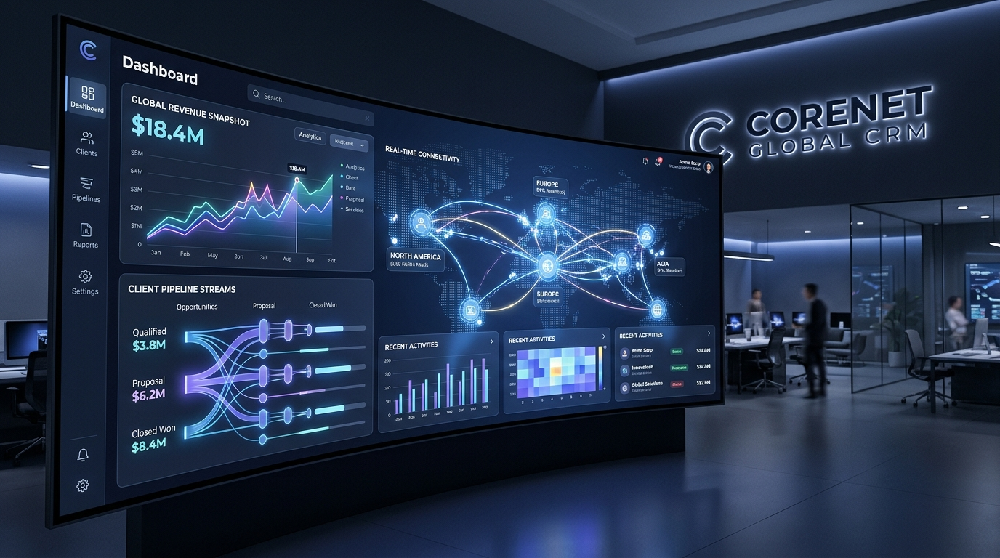

# NexusCRM Suite – Multilingual Enterprise CRM & Connected App Ecosystem



> **NexusCRM Suite** is an enterprise-grade Customer Relationship Management (CRM) application with native multilingual support (English default, Dutch, French, German, Spanish) and unified bidirectional links to **RosterSync Pro**, **TalentPulse HRIS**, **Kopilot Projects**, and **BoekhoudGemak**.

🚀 **Live Production Version / Live Applicatie**: [https://nexuscrm-suite.lucifera.eu](https://nexuscrm-suite.lucifera.eu)

---

## 🌐 Language Navigation / Taalnavigatie
- [English Documentation](#-english-documentation)
- [Nederlandse Documentatie](#-nederlandse-documentatie)
- [📱 Progressive Web App (PWA)](#-progressive-web-app-pwa)
- [💖 Sponsor & Support](#-sponsor--support--sponsoring--ondersteuning)

[](https://nexuscrm-suite.lucifera.eu)
[](https://nexuscrm-suite.lucifera.eu)
[](https://www.paypal.com/donate/?business=luciferamorgenster@gmail.com&no_recurring=0&currency_code=EUR)

---

## 🇬🇧 English Documentation

### 🌐 Live Production URL
Access the running cloud application directly at: **[https://nexuscrm-suite.lucifera.eu](https://nexuscrm-suite.lucifera.eu)**

### Overview
NexusCRM Suite provides enterprise teams with complete visibility into customer relationships, sales pipelines, and commercial interactions while eliminating data silos between CRM, workforce scheduling, human resource management, project operations, and financial accounting.

### 🌟 Key Capabilities
- **Sales Pipeline & Kanban Forecast**: Manage leads, qualified opportunities, proposals, negotiations, and closed deals with live pipeline valuations and win probability metrics.
- **360° Account & Contact Directory**: Maintain deep client intelligence including industry tags, health scores, communication logs, and associated internal stakeholders.
- **Unified Ecosystem App Hub**:
  - 🔄 **RosterSync Pro**: Track operational field shifts, service technician rosters, and on-site client dispatch allocations.
  - 👥 **TalentPulse HRIS**: Cross-reference dedicated account managers, assigned internal specialist teams, and human capital bandwidth.
  - 🚀 **Kopilot Projects**: Monitor active client project deliveries, sprint milestones, release dates, and project health indicators.
  - 💶 **BoekhoudGemak**: Synchronize financial invoicing, VAT numbers, annual recurring revenue (ARR), payment terms, and open balances.
- **Progressive Web App (PWA) Certified**: Installable on Windows, macOS, Android, and iOS with full standalone execution, service worker offline asset precaching, and in-app install buttons.
- **Native Multilingual Architecture**: Immediate runtime localization across 5 languages:
  - English (`en` - Default)
  - Nederlands (`nl` - Dutch)
  - Français (`fr` - French)
  - Deutsch (`de` - German)
  - Español (`es` - Spanish)
- **Comprehensive SEO & Social Share Optimization**:
  - Dynamically synchronized `document.title`, `meta[name="description"]`, and `html[lang]`.
  - OpenGraph (`og:image`, `og:title`, `og:description`, `og:url`, `og:locale`).
  - Twitter Card `summary_large_image` using the official 16:9 cover image.
  - Schema.org JSON-LD structured data (`SoftwareApplication`, `Organization`).
  - Hreflang alternate link tags for search engine bots.

### 🚀 Getting Started
```bash
# Install dependencies
npm install

# Start local development server (port 3000)
npm run dev

# Build for production
npm run build
```

---

## 🇳🇱 Nederlandse Documentatie

### 🌐 Live Productie URL
De live versie is 24/7 bereikbaar via: **[https://nexuscrm-suite.lucifera.eu](https://nexuscrm-suite.lucifera.eu)**

### Overzicht
NexusCRM Suite biedt commerciële en operationele teams compleet inzicht in klantrelaties, verkooptrajecten en klantinteracties. Het overbrugt de kloof tussen relatiebeheer, personeelsplanning, projectuitvoering en financiële boekhouding door directe koppelingen met uw bestaande bedrijfsapplicaties.

### 🌟 Belangrijkste Functionaliteiten
- **Verkooppijplijn & Kanban Verwachtingen**: Beheer leads, gekwalificeerde kansen, offertes, onderhandelingen en gewonnen deals met actuele omzetprognoses en winstkansen.
- **360° Klant- & Contactpersonendossier**: Volledig overzicht van bedrijfsgegevens, klantgezondheid, communicatiehistorie en toegewezen contactpersonen.
- **Geïntegreerde App Koppelingen**:
  - 🔄 **RosterSync Pro**: Direct inzicht in ingeplande shifts, velddienstplanning en serviceroosters gekoppeld aan de klant.
  - 👥 **TalentPulse HRIS**: Toewijzing van accountmanagers, medewerkersprofielen en interne teamcapaciteit.
  - 🚀 **Kopilot Projects**: Real-time projectstatus, sprint-deadlines en oplevering van klantprojecten.
  - 💶 **BoekhoudGemak**: Synchronisatie van facturatiestatus, btw-nummers, openstaande posten en jaarlijkse contractwaarde (ARR).
- **Progressive Web App (PWA) Ondersteuning**: Direct installeerbaar op desktop en smartphone als zelfstandige app zonder browserbalken, inclusief offline caching en installatieprompt.
- **Volledig Meertalig Systeem**: Directe wisseling tussen 5 talen zonder herladen:
  - Engels (`en` - Standaard)
  - Nederlands (`nl`)
  - Frans (`fr`)
  - Duits (`de`)
  - Spaans (`es`)
- **Geavanceerde Meertalige SEO & Social Media Kaarten**:
  - Dynamische updates van paginatitel, metabeschrijving en taalattributen.
  - OpenGraph metadata met weergave van de officiële 16:9 omslagafbeelding op sociale media (LinkedIn, Slack, WhatsApp, X).
  - Schema.org JSON-LD semantische structuur voor zoekmachines.
  - Hreflang alternatieve taallinks voor optimale indexering in Google.

### 🛠️ Technische Specificaties
- **Framework**: React 19 met TypeScript & Vite
- **PWA Tooling**: `vite-plugin-pwa` met Workbox runtime caching en Web App Manifest
- **Styling**: Tailwind CSS v4 met ondersteuning voor lichte en donkere modus
- **I18n**: Type-safe meertalige vertaalhook `useTranslation`
- **SEO**: Dynamische document synchronisatie & rich snippets (Schema.org)
- **Afbeeldingen & Iconen**: Hoge resolutie AI-gegenereerde omslagafbeelding (`/public/og-cover.jpg`) en PWA iconen (192x192, 512x512, maskable en Apple Touch Icon).

---

## 📱 Progressive Web App (PWA)

NexusCRM Suite meets all Google Lighthouse & Chromium PWA installation criteria:
- **Standalone Display**: Runs in its own dedicated application window without browser chrome.
- **Web App Manifest**: Contains validated `id`, `start_url`, `display`, `theme_color`, and icon sets.
- **Maskable & Apple Touch Icons**: Includes pixel-perfect 192x192, 512x512, maskable (safe-zone), and 180x180 PNG assets.
- **Service Worker Precaching**: Automatically precaches HTML, CSS, JavaScript, Web Fonts, and static image assets for instant loading and offline fallback.
- **In-App Installation Prompt**: Accessible directly via the install button in the navigation header, with custom step-by-step guidance for iOS Safari users.

---

## 💖 Sponsor & Support / Sponsoring & Ondersteuning

### 🇬🇧 Support the Project
If NexusCRM Suite brings value to your workflow or business operations, consider supporting its ongoing maintenance and new feature development.

- **PayPal Account**: [luciferamorgenster@gmail.com](mailto:luciferamorgenster@gmail.com)
- **Direct PayPal Link**: [Donate via PayPal to luciferamorgenster@gmail.com](https://www.paypal.com/donate/?business=luciferamorgenster@gmail.com&no_recurring=0&currency_code=EUR)

[](https://www.paypal.com/donate/?business=luciferamorgenster@gmail.com&no_recurring=0&currency_code=EUR)

### 🇳🇱 Ondersteun het Project
Waardeert u NexusCRM Suite en wilt u bijdragen aan verdere updates en verbeteringen van de applicatie en app-koppelingen? Elke bijdrage wordt enorm gewaardeerd!

- **PayPal Account**: [luciferamorgenster@gmail.com](mailto:luciferamorgenster@gmail.com)
- **Directe PayPal Donatielink**: [Doneren via PayPal aan luciferamorgenster@gmail.com](https://www.paypal.com/donate/?business=luciferamorgenster@gmail.com&no_recurring=0&currency_code=EUR)
